<!-- ═══════════════════════════  HEADER  ═══════════════════════════ -->
<p align="center">
  
</p>

<p align="center">
  <a href="https://git.io/typing-svg">
    
  </a>
</p>

<p align="center">
  
  
  <a href="https://www.kaggle.com/josemiguelricoa"></a>
  <a href="www.linkedin.com/in/jose-miguel-rico-acosta"></a>
  <a href="josemiguelrico68@gmail.com"></a>
  
</p>

<!-- ═══════════════════════════  SOBRE MÍ  ═══════════════════════════ -->
<h2>⚡ Sobre mí</h2>

<table>
<tr>
<td width="58%" valign="top">

Estudiante de **Ingeniería de Sistemas Cibernéticos** en Medellín. Me muevo en la frontera entre el **hardware y el software**: diseño la PCB, programo el microcontrolador, entreno el modelo de IA que corre dentro de él y termino con una **plataforma web o un dashboard** que convierte los datos en decisiones.

- 🔌 **IoT & Sistemas Embebidos** — ESP32, ESP32-CAM, Arduino, LoRa, sensores ambientales
- 🧠 **IA aplicada** — TinyML con Edge Impulse, redes neuronales en PyTorch
- 🛠️ **Diseño electrónico** — esquemáticos y PCB en KiCad, prototipado con impresión 3D
- 📊 **Analítica de datos** — Python, SQL, RStudio y dashboards en Power BI
- 🌐 **Web** — Flask, Firebase, HTML/CSS/JS, Tailwind

</td>
<td width="42%" valign="top">

```python
class JoseMiguel:
    rol      = "Cyber Systems Eng. Student"
    base     = "Medellín, CO 🇨🇴"
    stack    = ["Python", "C++", "SQL", "JS"]
    hardware = ["ESP32", "LoRa", "KiCad"]
    ia       = ["PyTorch", "TinyML"]

    def mision(self):
        return ("Construir hardware "
                "que piensa y datos "
                "que deciden.")
```

</td>
</tr>
</table>

<!-- ═══════════════════════════  STACK  ═══════════════════════════ -->
<h2>🧰 Stack tecnológico</h2>

<p align="center"><b>Lenguajes</b></p>
<p align="center">
  
</p>

<p align="center"><b>IA · Backend · Datos</b></p>
<p align="center">
  
</p>

<p align="center"><b>Hardware · Herramientas</b></p>
<p align="center">
  
</p>

<p align="center">
  
  
  
  
  
  
  
  
  
  
  
  
  
</p>

<!-- ═══════════════════════════  PROYECTOS  ═══════════════════════════ -->
<h2>🚀 Proyectos destacados</h2>

<table>
<tr>
<td width="50%" valign="top">

### 🌦️ ReWeather
**Estación meteorológica IoT de bajo costo** para zonas rurales sin conectividad. Nodo transmisor con ESP32 + sensores (temperatura, humedad, viento, lluvia, radiación solar y UV), enlace **LoRa** de largo alcance, **Firebase** y panel web en tiempo real. **PCB diseñada individualmente en KiCad.**

    

[📂 Repositorio](https://github.com/Mirep68/Smart-Weather-Monitoring-Platform) · [🌐 Plataforma en vivo](https://estacion-meteorologica-d167d.web.app/)

</td>
<td width="50%" valign="top">

### 😴 NightGuard
**Gafas inteligentes que detectan microsueño en conductores.** Una ESP32-CAM ejecuta un modelo de visión entrenado en **Edge Impulse (TinyML)** que clasifica ojo abierto/cerrado **sin internet** y dispara una alerta sonora. Batería recargable y estructura **impresa en 3D**.

    

[📂 Repositorio](https://github.com/Mirep68/Nightguard-Driver-Drowsiness-Detection)

</td>
</tr>
<tr>
<td width="50%" valign="top">

### 🧬 Vitalis IA
**Red neuronal (MLP) en PyTorch que predice riesgo metabólico laboral** con microdatos de la GEIH del DANE. Dashboard con **220.095 registros**, motor de inferencia en tiempo real y pérdida ponderada para priorizar el *recall* clínico (**7.880 trabajadores en alto riesgo** identificados). API Flask desplegada en Render.

    

[📂 Repositorio](https://github.com/Mirep68/Vitalis-IA-Dashboard)

</td>
<td width="50%" valign="top">

### 🎮 Video Game Sales Analytics
**Ciclo completo de analítica de datos** sobre ventas globales de videojuegos: limpieza en Python, modelado y consultas en **PostgreSQL**, estadística descriptiva en **RStudio** y **dashboard interactivo en Power BI**. Dataset procesado y **publicado en Kaggle**.

    

[📂 Repositorio](https://github.com/Mirep68/Global-Video-Game-Sales-Analysis) · [📊 Dataset en Kaggle](https://www.kaggle.com/datasets/josemiguelricoa/ventas-globales-de-videojuegos)

</td>
</tr>
</table>

<!-- ═══════════════════════════  ESTADÍSTICAS  ═══════════════════════════ -->
<h2>📈 Actividad en GitHub</h2>

<!-- Estas tarjetas las genera automáticamente el workflow .github/workflows/profile-cards.yml -->
<p align="center">
  
</p>
<p align="center">
  
  
</p>
<p align="center">
  
  
</p>

<p align="center">
  
</p>

<!-- ═══════════════════════════  SNAKE  ═══════════════════════════ -->
<h2>🐍 Mis contribuciones, devoradas</h2>

<!-- La genera .github/workflows/snake.yml en la rama "output" -->
<p align="center">
  <picture>
    <source media="(prefers-color-scheme: dark)" srcset="https://raw.githubusercontent.com/Mirep68/Mirep68/output/github-snake-dark.svg"/>
    <source media="(prefers-color-scheme: light)" srcset="https://raw.githubusercontent.com/Mirep68/Mirep68/output/github-snake.svg"/>
    
  </picture>
</p>

<!-- ═══════════════════════════  FOOTER  ═══════════════════════════ -->
<p align="center">
  <i>“Si se puede medir, se puede mejorar — y si se puede embeber, mejor.”</i>
</p>


